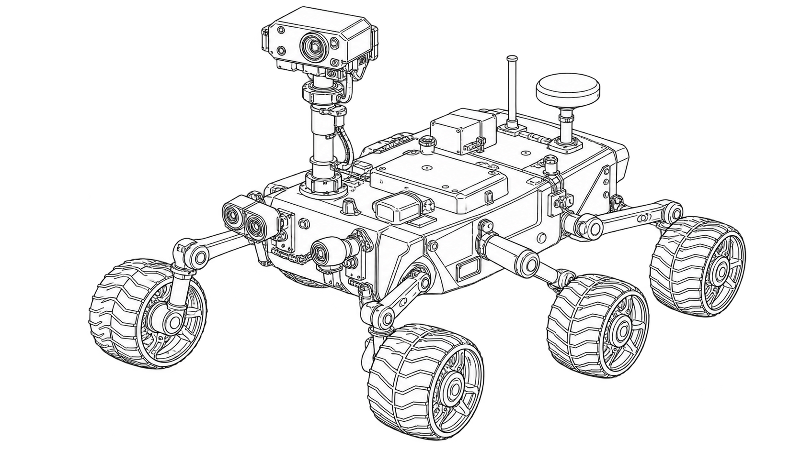

# Space Exploration Rover



*Generated line-art concept illustration.*

**Rover Ground Lab** is runnable navigation software, a browser replay lab, and a separate Arduino-compatible bench controller. It turns local range scans into a private grid, plans a route, and follows it with bounded left/right side speeds.

This project was built on 27 October 2026. It is a software and preliminary hardware package, not evidence of a physical rover or a space mission. The six-wheel skid-steer platform is approximated as two drive sides and a circular body. ROS, OpenCV, real LiDAR integration, localization and terrain slip are not implemented.

## Run the lab

Requires Node.js 22 or newer. The simulator has no runtime dependencies, accounts, model downloads, paid keys, or hardware connection.

```sh
git clone https://github.com/ungaaaabungaaa/space-exploration-rover.git
cd space-exploration-rover
npm ci
npm start
```

Open <http://127.0.0.1:8798>. Choose a scenario and a speed/step budget. Play, pause, step, or scrub actual recorded simulation states. The map shows discovered cells, measured ideal range rays and the accepted path. Numeric pose and side-speed values accompany the drawing. Full-world visibility is an observer option and does not give the planner extra knowledge.

The browser's bench-frame builder produces text only. It never opens a serial port. Exported replay JSON stays on your device.

## Use the CLI

```sh
node src/cli.mjs run --scenario detour --speed 0.6 --json
node src/cli.mjs run --scenario rocks --out new-replay.json
node src/cli.mjs packet --command A --sequence 1
node src/cli.mjs --help
```

The output path must be new; existing files are not overwritten. Packet mode only prints a CRC-protected frame. It does not send it anywhere.

## Navigation and motion

World coordinates use metres: x east, y north, heading counterclockwise from east in radians. Map rows run north-to-south. Each side speed is a linear wheel-ground speed in m/s, not wheel RPM or PWM. The model uses `v=(left+right)/2` and `omega=(right-left)/trackWidth`, following the [differential-drive convention documented by WPILib](https://docs.wpilib.org/en/stable/docs/software/kinematics-and-odometry/differential-drive-kinematics.html).

Perfect range beams update a private occupancy grid. The planner receives dimensions, that grid, pose and goal only. Unknown cells are provisionally open. A cardinal BFS route is revised when observed obstacles invalidate it. A waypoint controller limits yaw and side speed, applies a waypoint braking envelope, and bounds discrete side-speed changes. Velocities are held constant within a tick, so this is not a continuous torque or suspension model.

A **central simulator shield** checks the full curved swept body against ground truth. It splits exact arcs into chords with a conservative sagitta margin, then checks the entire expanded segment against obstacles and boundaries. Unsafe proposed motion is rejected before state/time advance. A `safety_stop` ends at the last accepted state, which can still have nonzero model velocity. It is not a verified physical braking maneuver.

See the [contract](docs/contract.md) and [methods](docs/methods.md) for formulas, bounds, geometry, sensing assumptions and outcome definitions.

## Measured scenario runs

```sh
npm run demo
npm run demo -- --check
```

Nine deterministic runs use the same radius 0.35 m, track 0.32 m, yaw limit 1.4 rad/s, side-speed slew 0.5 m/s², dt 0.1 s, 24 ideal beams, range 4 m and 2000-step budget. These are measured model outputs, not field trials.

| Terrain | Side-speed limit | Outcome | Simulated time | Accepted path |
| --- | --- | --- | --- | --- |
| Rock field | 0.3 m/s | arrived | 112.4 s | 21.85 m |
| Rock field | 0.6 m/s | arrived | 54.3 s | 22.03 m |
| Rock field | 0.9 m/s | arrived | 54.1 s | 22.45 m |
| Wall detour | 0.3 m/s | arrived | 150.9 s | 27.92 m |
| Wall detour | 0.6 m/s | arrived | 80.5 s | 28.01 m |
| Wall detour | 0.9 m/s | safety_stop | 37.7 s | 9.51 m |
| Blocked passage | 0.3 m/s | unreachable | 70.2 s | 12.76 m |
| Blocked passage | 0.6 m/s | unreachable | 36.3 s | 11.48 m |
| Blocked passage | 0.9 m/s | safety_stop | 37.7 s | 9.51 m |

The higher speed limit does not guarantee a faster or successful mission. Some tight turns require the central shield to reject motion; the simple controller is not complete or optimal. All returned accepted states passed the swept-path invariant. Zero accepted collisions is an enforced simulation property, not evidence of learned avoidance or physical safety. `unreachable` is reported only when no route remains even treating unknown cells as open. A short budget is reported as `budget`, never as arrival.

Raw [JSON](docs/results/scenario-runs.json) and [CSV](docs/results/scenario-runs.csv) include replans, goal error, observed cells, maximum accepted speeds/yaw/slew and rejected proposals. Recorded metrics use 1e-6 precision; no wall-clock performance claim is made. The browser result module is generated from the same actual runs and checked for consistency.

## Firmware and bench interface

The sketch targets an **Arduino Uno Rev3** and a PWM+direction dual-channel brushed-driver interface. Three wheels per side are only a future mechanical grouping; driver capacity, motors and wiring are not qualified by this code. The [preliminary hardware plan](docs/hardware-build.md) contains a BOM, pin map and staged checks.

- Neutral on boot; explicit ARM, MOVE and STOP.
- Fixed 64-byte input buffer, CRC8 and 16-bit freshness checks.
- PWM bounds ±180, lease 100–500 ms, normal slew 20 PWM units per 20 ms; reversal passes through zero.
- Invalid/stale/oversized input, unarmed movement, STOP or expired lease commands neutral and disarms. The lease is checked before processing incoming bytes.
- Bounded RX work and nonblocking best-effort telemetry prevent a full transmit queue from delaying control.

These are software command checks. PWM is open-loop and is not calibrated physical speed. A separate supply-cut emergency stop remains necessary.

Compile only, with official [Arduino CLI](https://github.com/arduino/arduino-cli/releases/tag/v1.5.1):

```sh
arduino-cli core update-index
arduino-cli core install arduino:avr@1.8.8
arduino-cli compile --fqbn arduino:avr:uno --warnings all firmware/rover
```

The local compile used CLI 1.5.1 and AVR core 1.8.8: 5836 bytes flash and 307 bytes global SRAM. Warnings were in the supplied Arduino core's unused `tag` parameters. No upload, serial device opening or physical motor test was performed.

Test the actual controller header natively and exercise the opt-in host without hardware:

```sh
npm run test:firmware
python3 tests/host_test.py
printf 'arm\nmove 30 -30\nstop\n' | python3 tools/serial_host.py --dry-run
```

The optional host uses Python's standard library. Its physical transport requires an explicit POSIX `--port` path and a matching acknowledgment before movement. It sends no automatic movement retries or keepalive; a move is only one bounded lease. Opening some USB serial ports can reset an Uno. Read the [protocol and bench guide](docs/firmware-bench.md) before selecting a real device. No automatic flashing is provided.

## Check and build

```sh
npm run check
npm run test:coverage
npm run demo -- --check
```

Core tests cover units, side-speed/yaw/slew limits, thin obstacles, curved-path collisions, private-map routes, blocked goals, work bounds, determinism and failure reports. Native C++ tests use address/undefined-behavior sanitizers for the actual firmware controller. Python tests include a disposable pseudo-terminal with fragmented telemetry; that is not a physical UART test.

`npm run build` copies ten public lab files into `dist/`. Firmware and host-device code are separate and are not exposed by the local server. See [deployment](docs/deployment.md), [verification](docs/verification.md), [security](SECURITY.md) and [contributing](CONTRIBUTING.md).

## Repository history and artwork

This repository was `arduino_myProject`. Original revision `005549f9d996ea1f9df9afabf17ecddddf72f5fc` remains on [`archive/before-space-rover-2026-10-27`](https://github.com/ungaaaabungaaa/space-exploration-rover/tree/archive/before-space-rover-2026-10-27). Earlier stars and history predate this project. Legacy sketches were not reused. [MIT](LICENSE) applies to new files only.

The cover is user-approved generated concept art, with [portable provenance](docs/images/cover-provenance.json). It is not a physical build photograph or measured result. MyPortfolio source, images, descriptions and deployment remain unchanged.
